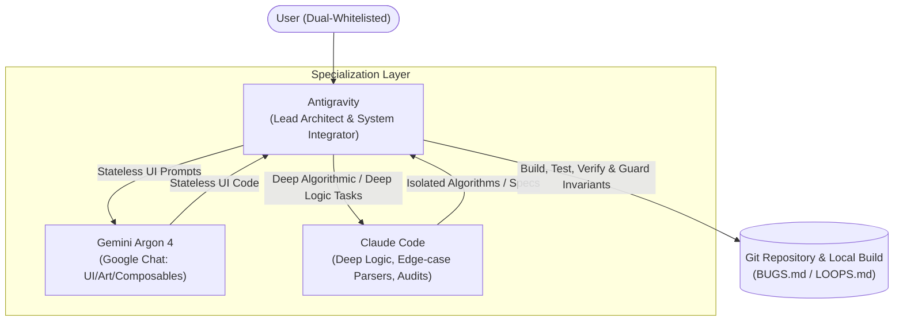

# Orbit / JobPilot Multi-Agent Orchestration & Workflow Guide (`WORKFLOW.md`)

> **Operating Principle**: Maximum productivity, zero merge regressions, and strict $0.00 cost enforcement through disciplined task segregation between **Antigravity**, **Claude Code**, and **Gemini Argon 4**.

---

## 1. Tri-Agent Responsibility Matrix

| Agent | Core Responsibilities | Capability Strengths | Task Assignment Boundary |
| :--- | :--- | :--- | :--- |
| **Antigravity** *(This Agent)* | • System Architecture & Lifecycle • Room DB, Repositories, ViewModels • FastAPI Backend, Router Wiring • Gradle & Pytest Test Execution • Git Commits, Pushes & CI/CD • Invariant & Regression Guard | • Full repo awareness • OS & Device tooling (ADB, USB) • Build & test automation • Token & zero-cost enforcement | **All system code, state management, testing, and file integration.** Never delegates stateful logic to external UI prompts. |
| **Claude Code** | • Complex Algorithmic Optimization • Complex Document/AST Parser Logic • Adversarial Prompt Review • Difficult Data Structures & Graph Traversal | • Deep contextual reasoning • Complex multi-step algorithmic code • Formal verification | **Isolated algorithmic logic, complex parser functions, edge-case math.** Operates on dedicated branches or isolated utility files. |
| **Gemini Argon 4** *(Google Chat)* | • Visual Art & Aesthetic Tokens • Jetpack Compose Layouts • 120Hz VRR Animations & Springs • Typography & Tabular Numerals | • High-fidelity Material3 / Bento aesthetics • Fine-tuned layout ergonomics • Instant interactive styling | **Strictly STATELESS UI Composables.** Receives data properties, emits callback lambdas. Never writes business logic, network calls, or Room queries. |

---

## 2. Rules for Simultaneous Antigravity & Claude Code Collaboration

To ensure Claude Code and Antigravity collaborate in the same repository without merge conflicts, ping-pong regressions, or file clobbering:

1. **Branch Segregation Rule**:
   - Claude Code works on dedicated task branches (e.g. `feature/claude-parser-optimizer`, `audit/claude-security-review`).
   - Antigravity operates on `main` or merges Claude Code's branches after running `./gradlew test` and `pytest`.
2. **File Boundary Rule**:
   - Claude Code handles isolated algorithmic functions (e.g. `app/services/algorithms/`, mathematical scorers, regex grammars).
   - Antigravity owns core wiring (`MainActivity.kt`, `AppDatabase.kt`, `main.py`, `config.py`, routes).
3. **Invariant Protection Gate**:
   - Before any code from Claude Code is merged into `main`, Antigravity verifies it against `BUGS.md` invariants (`INVARIANT-01` through `INVARIANT-10`).
   - If tests fail, Antigravity diagnoses and rejects or fixes the regression before committing.

---

## 3. Required Production Resources & Setup Checklist

To transition JobPilot from local mock development to full production deployment, the following $0.00 resources will be configured:

### 🔑 Resource 1: Google AI Studio Gemini API Key
- **Cost**: **$0.00** (Free Tier: 15 Requests/Min, 1,500 Requests/Day, 1M Tokens/Min).
- **Purpose**: Powers real-time resume tailoring and AI interview prep generation.
- **Where to obtain**: [aistudio.google.com](https://aistudio.google.com) -> "Get API Key".
- **Environment Variable**: `GEMINI_API_KEY` (configured in `backend/.env` or Google Cloud Run Secrets).

### 🔑 Resource 2: Firebase Service Account Credentials
- **Cost**: **$0.00** (Spark Plan: 50k Phone/Email Auth verifications/month free).
- **Purpose**: Verifies Google ID tokens on Cloud Run backend against the dual whitelist (`sireesh0204@gmail.com`, `bhargaviyerroju@outlook.com`).
- **Where to obtain**: Firebase Console -> Project Settings -> Service Accounts -> "Generate new private key".
- **Target File**: `backend/firebase_credentials.json` (strictly ignored by `.gitignore`).

### 🔑 Resource 3: Google Drive & Google Docs OAuth / Service Account
- **Cost**: **$0.00** (Google Workspace / Personal Drive API free quota).
- **Purpose**: Direct 1-tap upload of tailored resumes as `Company_Position_ExpiryDate.pdf` and direct importing of master resumes from Google Docs.
- **Where to obtain**: Google Cloud Console -> APIs & Services -> Enable "Google Drive API" -> Create OAuth Client ID / Service Account.

### 🔑 Resource 4: Apify Scraper Free-Tier Rotation Tokens
- **Cost**: **$0.00** ($5 free usage credit per month per account).
- **Purpose**: Powers background scraping runs on LinkedIn (`f_TPR=r300`), Naukri, and Indeed.
- **Strategy**: 2–3 free accounts rotated periodically to ensure $0 billing.

---

## 4. Immediate Next Step Checklist

- [x] Tri-Agent workflow architecture locked and documented.
- [x] Full Android & Backend unit test suites passing (62 backend tests, 44 Gradle tasks).
- [x] GitHub CI/CD automated APK build workflow (`.github/workflows/build-apk.yml`) pushed to `origin/main`.
- [ ] Configure `GEMINI_API_KEY` from Google AI Studio.
- [ ] Stage `firebase_credentials.json` for live Cloud Run token verification.
- [ ] Wire `ResumeTailorBottomSheet.kt` for 1-tap resume tailoring from the cockpit.
