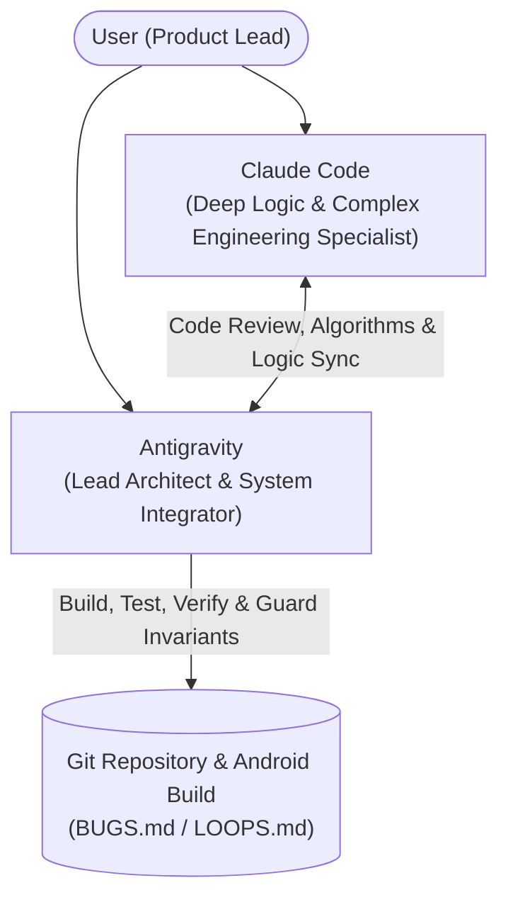

# Orbit / JobPilot Multi-Agent Orchestration & Workflow Guide (`WORKFLOW.md`)

> **Operating Principle**: Maximum productivity, zero merge regressions, and strict $0.00 cost enforcement through direct collaboration between **Antigravity** and **Claude Code**.

---

## 1. Dual-Agent Responsibility Matrix

| Agent | Core Responsibilities | Capability Strengths | Task Assignment Boundary |
| :--- | :--- | :--- | :--- |
| **Antigravity** *(This Agent)* | • System Architecture & State Lifecycle • Room Database, Repositories, ViewModels • FastAPI Backend, Router Wiring • Local Gradle & Pytest Test Execution • Git Commits, Pushes & CI/CD • Invariant & Regression Guard (`BUGS.md`) | • Full repository context • OS & Device tooling (ADB, USB) • Build & test automation • $0.00 Cost enforcement | **Single owner of repository state, wiring, builds, and invariant verification.** Integrates and tests all modules before committing. |
| **Claude Code** | • Complex Algorithmic Optimization • Complex Document/AST Parser Logic • Hard Heuristics & Scoring Mechanics • Adversarial Verification & Prompt Audits • Advanced Jetpack Compose UI Refinement | • Deep contextual reasoning • Complex multi-step algorithmic code • Formal verification & deep logic | **Deep algorithmic logic, complex parser functions, edge-case math, and architectural optimization.** Works in peer collaboration with Antigravity. |

---

## 2. Rules for Antigravity & Claude Code Collaboration

1. **Branch / File Boundary Discipline**:
   - Claude Code handles isolated algorithmic functions, complex modules, and deep code reviews.
   - Antigravity owns core wiring (`MainActivity.kt`, `AppDatabase.kt`, `main.py`, `config.py`, routes).
2. **Invariant Protection Gate**:
   - Before any code from Claude Code is merged or committed, Antigravity verifies it against `BUGS.md` invariants (`INVARIANT-01` through `INVARIANT-10`).
   - If tests fail, Antigravity diagnoses and resolves the regression before committing.
3. **One Atomic Commit Per Feature/Fix**:
   - Every completed sub-task is verified with `./gradlew test` and `pytest backend/tests -v` before committing with a descriptive commit message.

---

## 3. Required Production API Keys & Direct Links

| Service | Purpose | Free Tier Allowance | Direct Link to Obtain Key |
| :--- | :--- | :--- | :--- |
| **Google AI Studio** | Gemini Flash (Tailoring & Interview Prep) | 15 RPM / 1,500/day / 1M tokens/min ($0.00) | [aistudio.google.com/app/apikey](https://aistudio.google.com/app/apikey) |
| **Firebase Console** | Google Auth ID Token Verification Service Account | 50,000 phone/email authentications/month ($0.00) | [console.firebase.google.com](https://console.firebase.google.com/) |
| **Google Cloud Drive API** | Direct 1-tap Upload & Google Docs Import | Standard Google Workspace/Personal Free Quota ($0.00) | [console.cloud.google.com/apis/library/drive.googleapis.com](https://console.cloud.google.com/apis/library/drive.googleapis.com) |
| **Apify Console** | Sub-Hour LinkedIn, Naukri & Indeed Scraper | $5 free monthly credit per account ($0.00) | [console.apify.com/account/integrations](https://console.apify.com/account/integrations) |

---

## 4. Immediate Next Step Checklist

- [x] Dual-Agent workflow architecture locked and documented.
- [x] ASZSD brand logo added to Orbit repository header.
- [x] Soniq DSP v1.0.0 APK release published on GitHub.
- [x] JobPilot v1.0.0 APK release published on GitHub.
- [ ] Configure `GEMINI_API_KEY` from Google AI Studio.
- [ ] Stage `firebase_credentials.json` for live Cloud Run token verification.
- [ ] Wire `ResumeTailorBottomSheet.kt` for 1-tap resume tailoring from the cockpit.
